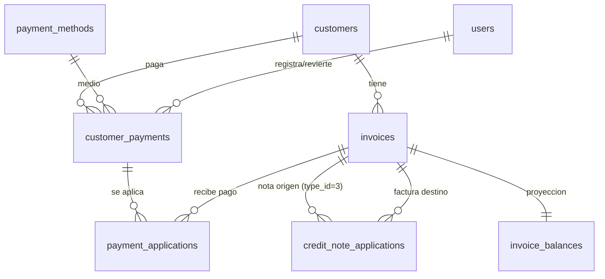

# JOR-171 — Modelo de datos: saldo, pagos y estados comerciales en el listado de Facturas Cliente

Alcance: modelo de datos que soporta (1) el registro persistente de pagos de cliente y su aplicación a facturas, (2) la proyección única de saldo (T-05), (3) los estados comerciales R-05 y (4) los filtros/tarjetas del listado. Base: PostgreSQL 16 + Knex. Aislación por `workspace_id` en todas las tablas.

Fuente: `JOR-166-JOR-167-decisiones-desarrollo-2026-10-06.md` §3 (R-01 a R-05), §4.1 (P-13.1, P-14.1, P-14.2), §5 (T-05). Código verificado en `backend/jormat-api/src/payments/payments.service.ts:63` (SEED), `backend/jormat-api/src/sales/sales.service.ts`, `backend/jormat-api/src/sales/sales.repository.ts`, `migrations/20261003000000_invoices_legacy.ts`, `migrations/20261003000012_invoices_sales_persistence.ts`, `migrations/20261001000008_payment_methods_legacy.ts`.

## 1. Resumen de cambios

| Objeto | Estado | Rol en JOR-171 |
| --- | --- | --- |
| `invoices` | EXISTENTE (se consume; sin columnas nuevas obligatorias) | Documento de venta: `total`, `expiration_date`, `is_draft`, `folio`, `type_id`, `customer_id`. Fuente del saldo y del estado comercial. |
| `invoice_items` | EXISTENTE | Sin cambios. |
| `payment_methods` | EXISTENTE (reutilizada, ENF-01) | Catálogo de medios (`name`, `payment_term`, `is_credit`). FK del medio del pago. |
| `customers` | EXISTENTE (se referencia) | Dueño de la deuda (`customers.id`). |
| `users` | EXISTENTE (se referencia) | Autor del pago / de la reversión (`users.id`, uuid). |
| `customer_payments` | NUEVA | Cabecera del pago (cliente, fecha, importe, medio, referencia, usuario, vigente/revertido). |
| `payment_applications` | NUEVA | Aplicación de un pago a una factura (importe aplicado). |
| `credit_note_applications` | NUEVA (preparada; la llena 5/7) | Aplicación de una nota de crédito a una factura. Necesaria para que la proyección REQ-02 ya la contemple. |
| `invoice_balances` | NUEVA (vista) | Proyección única de saldo + estado comercial + vencida (T-05). |

No se crea tabla de "vencidas" (REQ-02) ni tabla de medios de pago (ENF-01).

## 2. Relaciones



## 3. `customer_payments` — NUEVA

Cabecera del pago de cliente (módulo Cobranza). Reemplaza la semilla en memoria de `PaymentsService`.

| Columna | Tipo | Oblig. | Default | FK / Enum | Notas |
| --- | --- | --- | --- | --- | --- |
| `id` | serial | sí | — | PK | Id interno (correlativo). |
| `uuid` | uuid | sí | `uuid_generate_v4()` | UNIQUE | Id público expuesto por la API (contrato `id`). |
| `workspace_id` | uuid | sí | DEV `1111…1111` | — | Aislación de tenant (RULE-global-002). |
| `customer_id` | integer | sí | — | FK `customers(id)` ON DELETE RESTRICT | Cliente dueño del pago (`customers.id` entero, T-01). |
| `date` | date | sí | — | — | Fecha del pago (contrato `fecha`). |
| `total` | decimal(14,2) | sí | 0 | CHECK `>= 0` | Importe del pago (contrato `total`). Nombre alineado a `invoices.total` / `import_registration_payments.total`. |
| `payment_method_id` | integer | sí | — | FK `payment_methods(id)` ON DELETE RESTRICT | Medio (contrato `formaPago`). Reutiliza el catálogo (ENF-01). |
| `document_number` | varchar(50) | no | NULL | — | Referencia / n° de comprobante (contrato `nroDoc`). |
| `observation` | varchar(300) | sí | — | — | Observación obligatoria (JOR-113, DEC-012). Límite 300 del DTO. |
| `created_by` | uuid | no | NULL | FK `users(id)` ON DELETE SET NULL | Usuario que registra el pago (contrato `usuario`, derivado por join). |
| `status` | varchar(10) | sí | `'vigente'` | CHECK IN (`vigente`,`revertido`) | Estado del pago (REQ-01). |
| `reverted_at` | timestamptz | no | NULL | — | Fecha de reversión (al "eliminar" un pago). |
| `reverted_by` | uuid | no | NULL | FK `users(id)` ON DELETE SET NULL | Usuario que revierte. |
| `created_at` | timestamptz | sí | `now()` | — | |
| `updated_at` | timestamptz | sí | `now()` | — | |

Índices:
- `idx_customer_payments_workspace_id (workspace_id)`
- `idx_customer_payments_customer (workspace_id, customer_id)`
- `idx_customer_payments_date (workspace_id, date)`
- `idx_customer_payments_status (workspace_id, status)`
- `idx_customer_payments_method (payment_method_id)`

Reglas de integridad:
- `total >= 0` (check). El pago nace `vigente`; revertir es `status='revertido'` + `reverted_at`/`reverted_by` (no borrado físico). El `DELETE /pagos/:id` existente pasa a ser esta reversión.
- El `customer_id` debe coincidir con el cliente de las facturas a las que se aplica (invariante de aplicación, se controla en el servicio, no en DB).

Notas de migración: tabla creada en este ticket. Sin backfill (el SEED de pagos es demo y no se importa). `status` reemplaza conceptualmente a `in_status` legacy (que no se trae).

## 4. `payment_applications` — NUEVA

Aplicación (imputación) de un pago a una factura. Desacopla la cabecera del pago de las facturas, para soportar pago parcial, pago repartido entre facturas y el futuro crédito disponible (P-10.2.D1).

| Columna | Tipo | Oblig. | Default | FK / Enum | Notas |
| --- | --- | --- | --- | --- | --- |
| `id` | serial | sí | — | PK | |
| `uuid` | uuid | sí | `uuid_generate_v4()` | UNIQUE | Coherencia con el resto de las tablas. |
| `workspace_id` | uuid | sí | DEV | — | Aislación de tenant. |
| `payment_id` | integer | sí | — | FK `customer_payments(id)` ON DELETE CASCADE | Pago que se aplica. |
| `invoice_id` | integer | sí | — | FK `invoices(id)` ON DELETE CASCADE | Factura destino (documento de venta). |
| `amount` | decimal(14,2) | sí | — | CHECK `> 0` | Importe aplicado (contrato "importe aplicado"). |
| `created_by` | uuid | no | NULL | FK `users(id)` ON DELETE SET NULL | Autor de la imputación. |
| `created_at` | timestamptz | sí | `now()` | — | |
| `updated_at` | timestamptz | sí | `now()` | — | |

Índices y constraints:
- UNIQUE `(payment_id, invoice_id)` — un pago se aplica una sola vez por factura.
- `idx_payment_applications_payment (payment_id)`
- `idx_payment_applications_invoice (invoice_id)`
- `idx_payment_applications_workspace (workspace_id)`

Reglas: la suma de aplicaciones de un pago vigente no debe superar su `total` (se valida en el servicio al aplicar, bajo transacción). Aplicar pago + su `payment_applications` es una sola transacción (REQ-01).

Notas de migración: creada en este ticket. Sin backfill.

## 5. `credit_note_applications` — NUEVA (preparada; la llena 5/7)

Creada vacía en este ticket para que la proyección de saldo (REQ-02: `total − pagos aplicados − notas de crédito aplicadas`) ya la contemple y no haya que reescribir la vista en 5/7.

| Columna | Tipo | Oblig. | Default | FK / Enum | Notas |
| --- | --- | --- | --- | --- | --- |
| `id` | serial | sí | — | PK | |
| `uuid` | uuid | sí | `uuid_generate_v4()` | UNIQUE | |
| `workspace_id` | uuid | sí | DEV | — | Aislación de tenant. |
| `credit_note_id` | integer | sí | — | FK `invoices(id)` ON DELETE CASCADE | Documento origen; debe ser `type_id=3` (nota de crédito). Invariante a validar al insertar (5/7). |
| `invoice_id` | integer | sí | — | FK `invoices(id)` ON DELETE CASCADE | Factura destino a la que baja el saldo. |
| `amount` | decimal(14,2) | sí | — | CHECK `> 0` | Importe anulado/aplicado. |
| `created_by` | uuid | no | NULL | FK `users(id)` ON DELETE SET NULL | |
| `created_at` | timestamptz | sí | `now()` | — | |
| `updated_at` | timestamptz | sí | `now()` | — | |

Índices: UNIQUE `(credit_note_id, invoice_id)`; `idx_credit_note_applications_credit_note (credit_note_id)`; `idx_credit_note_applications_invoice (invoice_id)`.

Notas: en JOR-171 queda en 0 filas; su lógica de negocio (anulación, stock, crédito disponible) es de 5/7 (P-10.1/P-10.2). Marcada explícitamente para no usarse desde endpoints de este ticket.

## 6. `invoice_balances` — NUEVA (vista, proyección única T-05)

Única fuente de saldo compartida por estado, listado, tarjetas, popup (4/7) y Estado de cuenta (4/7). No es una tabla; no se materializa estado.

| Columna | Tipo | Origen | Notas |
| --- | --- | --- | --- |
| `workspace_id` | uuid | `invoices.workspace_id` | Filtro de tenant en cada consulta. |
| `invoice_id` | integer | `invoices.id` | |
| `uuid` | uuid | `invoices.uuid` | Id público. |
| `customer_id` | integer | `invoices.customer_id` | |
| `type_id` | integer | `invoices.type_id` | Para excluir guías (`type_id <> 5`, R-01). |
| `is_draft` | smallint | `invoices.is_draft` | Borrador = fuera de deuda (R-05). |
| `total` | decimal | `invoices.total` | |
| `applied_payments` | decimal | `COALESCE(SUM(payment_applications.amount)` con pago `status='vigente'`, 0) | |
| `applied_credit_notes` | decimal | `COALESCE(SUM(credit_note_applications.amount), 0)` | 0 en JOR-171. |
| `balance` | decimal | `GREATEST(invoices.total − applied_payments − applied_credit_notes, 0)` | Saldo (piso 0; ver Decisión D-3). |
| `is_overdue` | boolean | `balance > 0 AND expiration_date < CURRENT_DATE AND is_draft = 0` | Plazo cumplido. |
| `commercial_state` | text | CASE: `borrador` / `pagada` / `vencida` / `pendiente_pago` | R-05 (ver §7). |

Definición propuesta:

```sql
CREATE VIEW invoice_balances AS
SELECT
  i.workspace_id,
  i.id   AS invoice_id,
  i.uuid,
  i.customer_id,
  i.type_id,
  i.is_draft,
  i.total,
  COALESCE(p.paid, 0)   AS applied_payments,
  COALESCE(c.credit, 0) AS applied_credit_notes,
  GREATEST(i.total - COALESCE(p.paid,0) - COALESCE(c.credit,0), 0) AS balance,
  (i.is_draft = 0
     AND i.total - COALESCE(p.paid,0) - COALESCE(c.credit,0) > 0
     AND i.expiration_date < CURRENT_DATE) AS is_overdue,
  CASE
    WHEN i.is_draft = 1 THEN 'borrador'
    WHEN i.total - COALESCE(p.paid,0) - COALESCE(c.credit,0) <= 0 THEN 'pagada'
    WHEN i.expiration_date < CURRENT_DATE THEN 'vencida'
    ELSE 'pendiente_pago'
  END AS commercial_state
FROM invoices i
LEFT JOIN (
  SELECT a.invoice_id, SUM(a.amount) AS paid
  FROM payment_applications a
  JOIN customer_payments cp ON cp.id = a.payment_id AND cp.status = 'vigente'
  GROUP BY a.invoice_id
) p ON p.invoice_id = i.id
LEFT JOIN (
  SELECT invoice_id, SUM(amount) AS credit
  FROM credit_note_applications
  GROUP BY invoice_id
) c ON c.invoice_id = i.id
WHERE i.is_active = 1;
```

Índices de apoyo (ver §8) hacen viable la agregación por `invoice_id`. Si el volumen lo exige más adelante, la vista se puede materializar (ver Decisión D-1).

## 7. Estados comerciales (R-05) — derivados, no persistidos

| Estado | Token | Condición |
| --- | --- | --- |
| Borrador | `borrador` | `is_draft = 1` (sin folio, fuera de deuda). |
| Pendiente de pago | `pendiente_pago` | emitida, `balance > 0`, `expiration_date >= CURRENT_DATE`. |
| Pagada | `pagada` | `balance = 0` (emitida). |
| Vencida | `vencida` | emitida, `balance > 0`, `expiration_date < CURRENT_DATE`. |

- Separados del estado SII (`invoices.sii_status`, simulado) — REQ-03. No se derivan de `invoices.commercial_status`.
- El plazo 30/60 queda materializado en `invoices.expiration_date` (Sales lo calcula desde `formaPago` crédito; `resolveVencimiento`). `payment_methods.payment_term` es el catálogo del plazo; la relación con el documento es por `invoices.payment_method_id` (ver Decisión D-2).
- No se persiste este estado en `invoices.commercial_status` (cambiaría por el paso del tiempo y por cada pago; quedaría obsoleto). Se calcula en la vista.

## 8. Índices sobre `invoices` (existentes que se agregan)

| Índice | Columnas | Motivo |
| --- | --- | --- |
| `idx_invoices_workspace_type` | `(workspace_id, type_id)` | Exclusión de guías (`type_id <> 5`) y filtro por tipoDTE. |
| `idx_invoices_workspace_expiration` | `(workspace_id, expiration_date)` | Estado Vencida y rango de vencimiento. |
| `idx_invoices_workspace_origin_name` | `(workspace_id, origin_name)` | Filtro R-03 "Origen". |
| `idx_invoices_workspace_order_ref` | `(workspace_id, order_reference)` | Filtro R-03 "O.C." (columna "Orden"). |

Ya existentes y vigentes: `idx_invoices_workspace_id`, `idx_invoices_customer_id`, `idx_invoices_date`, `uq_invoices_workspace_type_folio`. La búsqueda por RUT/razón social usa `receiver_rut` / `receiver_razon_social` (sin índice hoy; ver Decisión D-4).

## 9. Migraciones

Orden (aditivo y reversible):

1. `20261008000000_customer_payments.ts`: crea `customer_payments` + índices.
2. `20261008000001_payment_applications.ts`: crea `payment_applications` + unique + índices.
3. `20261008000002_credit_note_applications.ts`: crea `credit_note_applications` (vacía) + unique + índices.
4. `20261008000003_invoice_balances_view.ts`: crea la vista `invoice_balances` e índices de `invoices` de §8.

`down()`: `DROP VIEW invoice_balances`, luego `DROP TABLE credit_note_applications`, `payment_applications`, `customer_payments`; quitar índices de `invoices`. Sin pérdida de datos de `invoices`.

Backfill: ninguno. Los documentos existentes quedan con `applied_payments = 0` → `balance = total` y estado derivado (Borrador/Pendiente/Vencida según `expiration_date`). No se importan pagos del SEED. `payment_methods` ya está sembrado (migración `20261001000014`).

`payment_methods` ya se normalizó (`name`, sin `in_status`); no se requiere cambio de estructura salvo la Decisión D-5 (mapeo de los 8 medios canónicos).

## 10. Impacto en consumidores

- `PaymentsService` (`payments.service.ts`): `findAllCobranza`, `getSummary`, `getInvoice`, `applyPayment`, `deletePayment` dejan de usar `SEED`/`in-memory` y pasan a `customer_payments` + `payment_applications` + `invoice_balances`. `deletePayment` pasa a reversión (`status='revertido'`).
- `SalesService` / `KnexSalesRepository`: el listado y el summary (`sales.service.ts:447`) leen `invoice_balances` para saldo/estado y filtran tarjetas; agregan `type_id <> 5` (R-01) y los filtros R-03 (RUT/nombre/Origen/O.C./fechas/estado comercial).
- Contrato (`sales/dto/documento.dto.ts`, `payments/dto/payments.dto.ts`): `ESTADO_COMERCIAL_VALUES` (hoy `aceptado/pendiente/rechazado`) pasa a los tokens R-05; se expone `balance`/`saldo` y `estadoComercial`. `payment_methods` alimenta el `formaPago` del pago.
- 4/7 (popup y Estado de cuenta) consumen la misma vista `invoice_balances` (T-05, T-12).

## 11. Decisiones y alternativas

D-1 · Proyección de saldo. Opciones: (A) vista `invoice_balances` [recomendada: una sola fuente, sin drift]; (B) columnas desnormalizadas `paid_applied`/`balance` en `invoices` [más rápidas, pero requieren disparadores/job y pueden quedar obsoletas]; (C) función SQL por consulta [sin objeto persistente, se repite en cada consumidor]. Se recomienda A; si el volumen lo exige, materializar la vista (no desnormalizar). Impacto: alto en consumidores, reversible.

D-2 · Plazo y `payment_term`. Opciones: (A) usar `invoices.expiration_date` como vencimiento (ya persistido por Sales) y poblar `invoices.payment_method_id` con el medio de crédito (`payment_methods.payment_term` 30/60) solo como traza [recomendada]; (B) agregar `payment_term_days` snapshot a `invoices` [explícito pero redundante con `expiration_date`]. Se recomienda A. Impacto: bajo.

D-3 · Piso del saldo. Opciones: (A) `GREATEST(balance, 0)` en la vista [recomendada para listado/estado: "Pagada" = 0]; (B) permitir saldo negativo como "crédito disponible" del cliente (P-10.2.D1). Se puede adoptar A ahora y exponer el excedente por separado en 5/7. Impacto: medio (semántica de Pagada).

D-4 · Búsqueda por RUT/razón social. Opciones: (A) agregar índice GIN trigram (`pg_trgm`) sobre `receiver_rut`/`receiver_razon_social`; (B) dejarla como ILIKE sin índice (aceptable a volumen bajo). Depende de que exista tráfico suficiente; se difiere salvo indicación.

D-5 · Mapeo de los 8 medios canónicos a `payment_methods`. Hoy el DTO usa tokens (`Efectivo`, `Visa Credito`, `Debito`, `Transferencia`, `Mercado Pago`, `WebPay`, `Cheque`, `Nota credito`) y el catálogo guarda `name` con acentos/espacios (`Visa crédito `, `Nota de credito`), sin columna de código. Opciones: (A) agregar `code varchar(40)` único por workspace a `payment_methods` y mapear por código [recomendada: estable ante renombres]; (B) mapear por `name` normalizado [sin migración, frágil]. Impacto: bajo; afecta `ImportsModule` que hoy lee `payment_methods.name`.

D-6 · Estado comercial persistido. Opciones: (A) no persistir; derivar en la vista y repurposar el contrato `estadoComercial` a R-05, dejando `invoices.commercial_status` como eje legacy sin uso en el listado [recomendada]; (B) migrar `commercial_status` a los valores R-05 y mantenerla con job [drift por tiempo/pagos]. Se recomienda A. Impacto: medio; toca el contrato con el front.

## 12. Fuera de alcance / preparado

- Notas de crédito: su creación, aplicación y efecto en stock son de 5/7. Aquí solo su tabla de aplicación (vacía) y el término en la vista.
- Cheques: la forma de pago `Cheque` se guarda como `payment_method_id`; la tabla/estado de cheques (T-11) es 4/7.
- `invoice_balances` no materializa "vencidas" (REQ-02); el estado se recalcula siempre.